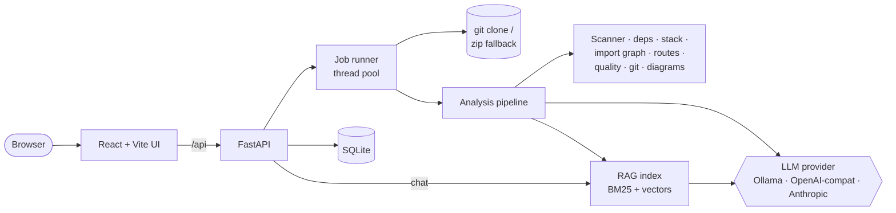

# RepoXray

**Paste a GitHub link. Get a map of the codebase.**

RepoXray clones any public (or private, with a token) GitHub repository and produces an interactive, visual
explanation of it: architecture map, flowcharts, tech stack, API routes, dependency health, code quality score,
security findings, commit activity, and a chat you can use to ask questions about the code. It uses retrieval-augmented
generation (RAG) over the repository's own files.

It works **with or without AI**. Static analysis produces every map, diagram, and score on its own. An LLM
(local **Ollama**, **Groq**, **Google Gemini**, **OpenAI**/compatible, or **Anthropic**) adds written explanations, smarter
improvement suggestions, and natural-language answers.

It is built to cope with real-world repositories: unfinished, outdated, undocumented, monorepos, repos with no
manifest, huge repos, repos with binary files or odd encodings, subfolders (`/tree/branch/path`), and repos whose
GitHub API calls are rate-limited.

---

## Features

| Area | What you get |
|---|---|
| **Overview** | Plain-English summary, purpose, "how it works" steps, key components, suggested reading order, run commands, env vars |
| **Architecture map** | Interactive, animated graph of modules or files, coloured by layer. Links are routed around boxes, flow to show direction, and light up with moving packets when you hover a box. Strongest-links filter, auto layout direction, full screen |
| **Flowcharts** | Animated Mermaid diagrams: layered architecture, execution flow, request lifecycle (plays step by step), build & run, folder mind map, AI data-flow. Pan/zoom, hover to highlight connections, Classic or Smart (ELK) layout, full screen, SVG export |
| **Tech stack** | 150+ technologies detected from manifests, config files and imports, grouped by category with evidence |
| **Files & code** | Explorer + size treemap, syntax-highlighted viewer, symbol outline, "Explain this file" |
| **API routes** | Endpoints from FastAPI, Flask, Django, Express, NestJS, Spring, Gin/Echo, Rails, Laravel, ASP.NET, Next.js |
| **Dependencies** | 12 ecosystems parsed; npm / PyPI / crates.io / Go versions checked for being outdated (major/minor/patch) |
| **Health** | 0–100 score over ~25 weighted checks (docs, tests, CI/CD, code quality, security, dependencies, maintenance) with prioritised fixes, complexity hotspots (complexity × churn), TODO/FIXME list |
| **Security** | Leaked secrets (AWS, GitHub, OpenAI, Stripe, private keys…), committed `.env` files, risky patterns (eval, `shell=True`, SQL formatting, disabled TLS…) |
| **Activity** | Commits per week/weekday, contributors, bus factor, recent commits |
| **Ask the code** | Streaming RAG chat. Hybrid BM25 + embedding retrieval, answers cite `file:line`, sources are clickable |
| **Export** | Markdown report and full JSON |

## Architecture



**Pipeline steps** (each reported live in the UI):
fetch → scan → dependencies (+ registry check) → stack → code graph (imports, symbols, routes, entry points) →
git history → quality & security → diagrams → RAG index → AI insights.

Partial results are saved after static analysis, so the dashboard is usable before the AI steps finish.

See [`docs/HOW_IT_WORKS.md`](docs/HOW_IT_WORKS.md) for the algorithms in detail.

## Tech stack

- **Backend:** Python 3.11+, FastAPI, httpx, NumPy, SQLite, git
- **Frontend:** React 18, TypeScript, Vite, Tailwind CSS, React Flow (`@xyflow/react`) + dagre, Mermaid, Recharts, highlight.js
- **AI:** Ollama (local), Groq, Google Gemini, OpenAI and any OpenAI-compatible API, Anthropic
- **RAG:** AST-aware chunking, BM25, dense embeddings (Ollama / OpenAI), reciprocal-rank fusion
- **Infra:** Docker, Docker Compose (optional Ollama service), GitHub Actions CI

---

## Quick start

### Easiest: double-click (Windows)

| File | What it does |
|---|---|
| **`Start RepoXray.bat`** | Starts Docker Desktop if needed and **opens your browser right away** on a "Starting RepoXray…" page that switches to the app (http://localhost:3000) by itself when it's ready. In the window: **O** opens RepoXray again, **S** stops it. |
| **`Start RepoXray (no Docker).bat`** | Same, without Docker (needs Python 3.11+ and Git; the interface comes pre-built). Opens your browser, which switches to http://localhost:8000 when ready. |
| **`Stop RepoXray.bat`** | Stops RepoXray. Your analyses are kept. |

macOS / Linux: `./start.sh` (Docker) does the same and opens the browser.
The first start takes 5–10 minutes (building); later starts take seconds.

### Option A: Docker Compose (recommended)

```bash
cp .env.example .env            # optional: add REPOXRAY_GITHUB_TOKEN
docker compose up --build
```

Open **http://localhost:3000**. The API is on http://localhost:8000 (docs at `/docs`).

To use **Ollama inside Docker** (pulls `llama3.1:8b` + `nomic-embed-text` on first start, several GB):

```bash
OLLAMA_URL=http://ollama:11434 docker compose --profile ollama up --build
```

If Ollama already runs on your computer, the default `OLLAMA_URL=http://host.docker.internal:11434` uses it.

### Option B: single container

```bash
docker build -t repoxray .
docker run -p 8000:8000 -v repoxray-data:/data repoxray
```

Open http://localhost:8000.

### Option C: local development

Requirements: Python 3.11+, Node 18+, git.

```bash
# backend
cd backend
python -m venv .venv && source .venv/bin/activate      # Windows: .venv\Scripts\activate
pip install -r requirements.txt
uvicorn app.main:app --reload --reload-dir app --port 8000

# frontend (second terminal)
cd frontend
npm install
npm run dev                                           # opens http://localhost:5173 automatically (proxies /api to :8000)
```

Or simply `make install && make dev`.

### Setting up AI

Open **Settings** in the app, choose a provider, paste a key if needed, and press **Save and test connection**.
Each provider remembers its own key and model, so you can switch between them freely.

| Provider | Cost | Get a key | Default chat model | Semantic search (embeddings) |
|---|---|---|---|---|
| **Ollama** | Free, runs on your laptop | none needed | `llama3.1:8b` | `nomic-embed-text` |
| **Groq** | Free tier, very fast | https://console.groq.com/keys | `llama-3.3-70b-versatile` | none, keyword search is used |
| **Google Gemini** | Free tier | https://aistudio.google.com/apikey | `gemini-2.5-flash` | `gemini-embedding-001` |
| **OpenAI / compatible** | Paid | https://platform.openai.com/api-keys | `gpt-4o-mini` | `text-embedding-3-small` |
| **Anthropic** | Paid | https://console.anthropic.com/settings/keys | enter a model ID | none, keyword search is used |

Model names change over time. After you save a key, the **Chat model** field lists the models your key can use.

Keys can be entered in **Settings** (stored on the server) **or** in `.env`:

```dotenv
REPOXRAY_GROQ_API_KEY=gsk_...
REPOXRAY_GEMINI_API_KEY=AIza...
```

A key typed in Settings overrides the one in `.env`. The provider cards show where each key comes from
("Key saved" or "Key from .env").

```bash
# Ollama setup
ollama pull llama3.1:8b
ollama pull nomic-embed-text
```

Already-finished analyses can be upgraded later with **Generate AI insights** on the Overview page.

---

## Configuration

All settings are environment variables prefixed with `REPOXRAY_` (see [`.env.example`](.env.example)).

| Variable | Default | Purpose |
|---|---|---|
| `REPOXRAY_GITHUB_TOKEN` | – | Higher GitHub API limit; private repos |
| `REPOXRAY_DATA_DIR` | `./data` | SQLite DB, clones, RAG indexes |
| `REPOXRAY_MAX_FILES` | `6000` | Files analysed in detail |
| `REPOXRAY_MAX_FILE_BYTES` | `600000` | Larger files are counted but not parsed |
| `REPOXRAY_MAX_REPO_MB` | `800` | Clones are aborted past this size |
| `REPOXRAY_CLONE_DEPTH` | `400` | Commits of history fetched |
| `REPOXRAY_CHECK_OUTDATED` | `true` | Query package registries |
| `REPOXRAY_WORKERS` | `2` | Concurrent analyses |
| `REPOXRAY_GROQ_API_KEY` | – | Groq key |
| `REPOXRAY_GEMINI_API_KEY` | – | Google Gemini key |
| `REPOXRAY_OPENAI_API_KEY` | – | OpenAI (or compatible) key |
| `REPOXRAY_ANTHROPIC_API_KEY` | – | Anthropic key |
| `REPOXRAY_LLM_PROVIDER` | `ollama` | Provider active on first start: `ollama` / `groq` / `gemini` / `openai` / `anthropic` / `none` |
| `REPOXRAY_LLM_MODEL` | `llama3.1:8b` | Chat model for that provider |
| `REPOXRAY_EMBED_MODEL` | `nomic-embed-text` | Embedding model for that provider |
| `REPOXRAY_LLM_BASE_URL` | `http://localhost:11434` | Ollama URL (set by Docker Compose from `OLLAMA_URL`) |
| `REPOXRAY_LLM_API_KEY` | – | Legacy generic key for `REPOXRAY_LLM_PROVIDER`; prefer the specific keys above |
| `REPOXRAY_LLM_CONTEXT_CHARS` | `24000` | Context budget sent to the model |

Settings saved in the UI override the environment defaults.

## REST API

| Method | Endpoint | Description |
|---|---|---|
| POST | `/api/analyze` | `{url, force?, use_llm?}` → `{id, cached}` |
| GET | `/api/analyses` | Recent analyses |
| GET | `/api/analyses/{id}` | Status, steps, and full result |
| GET | `/api/analyses/{id}/status` | Lightweight progress |
| DELETE | `/api/analyses/{id}` | Delete analysis, clone, and index |
| GET | `/api/analyses/{id}/file?path=` | File content + symbols |
| POST | `/api/analyses/{id}/explain` | `{path}` → Markdown explanation |
| GET | `/api/analyses/{id}/search?q=` | Hybrid code search |
| POST | `/api/analyses/{id}/chat` | `{question, history}` → NDJSON stream (`sources`, `token`, `done`) |
| POST | `/api/analyses/{id}/insights/regenerate` | Re-run AI insights |
| GET | `/api/analyses/{id}/report.md` · `report.json` | Exports |
| GET/PUT | `/api/settings/llm` | Read/update AI settings |
| POST | `/api/settings/llm/test` | Test the connection, chat, and embeddings |

Interactive docs: http://localhost:8000/docs

## Tests

```bash
cd backend && pip install pytest && pytest -q
```

Unit tests cover URL parsing, scanning, manifest parsing for several ecosystems, stack detection, import-graph
resolution (Python, TS path aliases), route extraction, entry-point ranking, diagram generation, tolerant LLM-JSON
parsing, and BM25 retrieval. `tests/mock_llm.py` is a fake Ollama/OpenAI server for testing AI features offline:

```bash
uvicorn tests.mock_llm:app --port 11999     # then set Base URL http://localhost:11999 in Settings
```

## Project structure

```
repoxray/
├── backend/
│   ├── app/
│   │   ├── main.py            # FastAPI routes
│   │   ├── config.py, db.py, jobs.py, report.py
│   │   ├── github.py          # URL parsing, metadata, clone + zip fallback, size guard
│   │   ├── analyzer/
│   │   │   ├── scanner.py     # file walk, languages, LOC, complexity, TODOs
│   │   │   ├── deps.py        # 12 manifest formats + outdated check
│   │   │   ├── stack.py       # technology detection, project type
│   │   │   ├── graph.py       # import graph, modules, layers, symbols, routes, entry points
│   │   │   ├── flows.py       # Mermaid diagram generation
│   │   │   ├── quality.py     # health score, security scan, improvements
│   │   │   ├── gitinfo.py     # history, contributors, churn
│   │   │   ├── docs.py        # README understanding, run commands, env vars
│   │   │   └── pipeline.py    # orchestration + progress
│   │   ├── llm/               # providers (Ollama/OpenAI/Anthropic) + insights
│   │   └── rag/               # chunking, BM25 + vector index, answer streaming
│   └── tests/
├── frontend/
│   └── src/
│       ├── pages/             # Home, Analysis, Settings
│       ├── sections/          # Overview, ArchitectureMap, Flows, Stack, Files, ApiRoutes, Dependencies, Health, Activity, Ask
│       ├── components/        # Mermaid, CodeView, Markdown, UI kit
│       └── lib/api.ts         # typed API client
├── docs/HOW_IT_WORKS.md
├── Start RepoXray.bat, Start RepoXray (no Docker).bat, Stop RepoXray.bat, start.sh
├── launcher/starting.html   # "Starting…" page that opens the app when ready
├── docker-compose.yml, Dockerfile, Makefile, .env.example
└── .github/workflows/ci.yml
```

## Limitations

- Import resolution is static. Dynamic imports, dependency injection, and reflection aren't followed.
- Route detection is pattern-based, so routes built at runtime may be missed.
- The security scan is a pattern scan, not a full audit.
- Quality of AI text depends on the model. Small local models (7–8B) give shorter, less precise insights than large hosted models.
- Supported hosting: GitHub (GitLab/Bitbucket would be a straightforward extension of `github.py`).

## Ideas for extension

GitLab/Bitbucket support · PR/diff analysis · tree-sitter parsing for more languages · call graphs ·
persistent vector DB (Qdrant/Chroma) · user accounts · scheduled re-analysis with trend charts · VS Code extension.

## License

MIT
